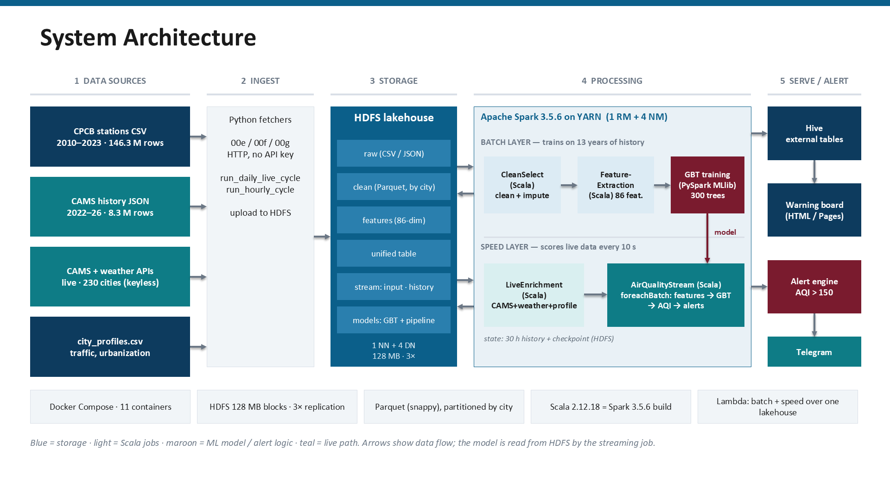
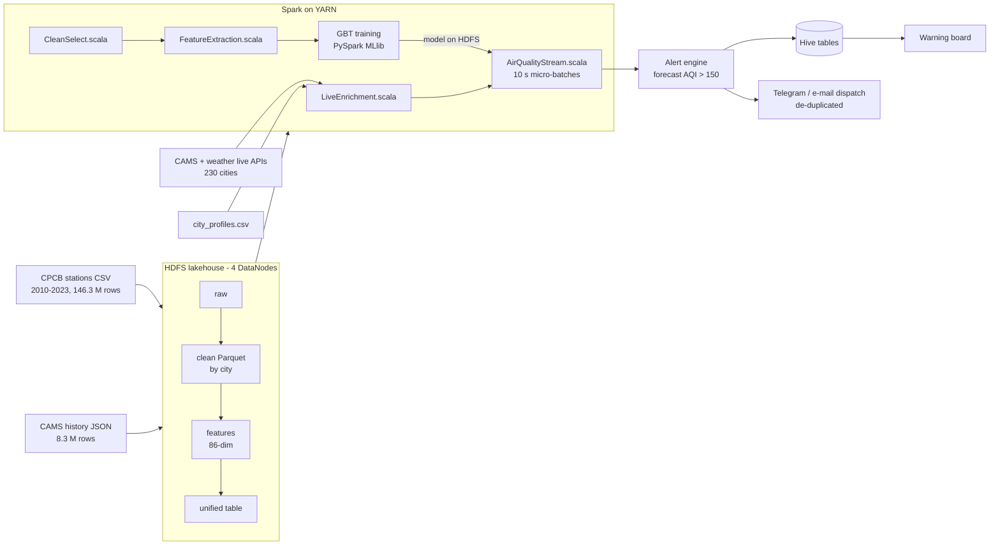

# A Scalable Big Data Platform for Real-Time Urban Air Quality Tracking and Public Safety Alerting

**23AID302 Big Data Analytics · Group A14**
Sangeeth S (CB.AI.U4AID24050) · Jaganath R (CB.AI.U4AID24021) · Niranjan S (CB.AI.U4AID24035) · PL Kowshik (CB.AI.U4AID24036)

A distributed pipeline that forecasts each city's PM₂.₅ one hour ahead, converts the forecast into a CPCB Air Quality Index, and turns it into a public warning message before the pollution arrives.
Built on **Hadoop HDFS, YARN, Spark 3.5 (Scala 2.12 + PySpark MLlib), Spark Structured Streaming and Hive**.

## Website

**Public warning board:** https://jaganath010.github.io/A-Scalable-Big-Data-Platform-for-Real-Time-Urban-Air-Quality-Tracking-and-Public-Safety-Alerting/

> Served by GitHub Pages from `docs/index.html` (enable once under *Settings → Pages → Branch: main, folder: /docs*).
> It is a single static file: it also opens directly from `dashboard/AirWatch_India.html` with no server.
> It shows the warnings from the October 1–15, 2026 live run (221 cities), the message each city would receive, a map, and an "Alert me" notification button.

## Documents

| | |
|---|---|
| Full project report (25 pages) | [`docs/PROJECT_REPORT.pdf`](docs/PROJECT_REPORT.pdf) · [`docs/PROJECT_REPORT.docx`](docs/PROJECT_REPORT.docx) |
| Final presentation (10 slides + evidence appendix) | [`presentation/Final_Project_Presentation.pptx`](presentation/Final_Project_Presentation.pptx) |
| First review presentation | [`presentation/1st_Review_Presentation.pptx`](presentation/1st_Review_Presentation.pptx) |

## Results at a glance

| | |
|---|---|
| Unified dataset | **154,583,979 rows**, 33 GB, 241 cities / 4,077 stations, structured CSV + semi-structured JSON on one schema |
| Forecast model | 300-tree Gradient-Boosted Trees: **R² 0.8910 vs 0.8587** for the persistence baseline, **RMSE −12.18 %** on 2.07 M real rows (all 18.7 M test rows: R² 0.8884 vs 0.8563) |
| Features | 86 (54 numeric + 32 one-hot), 93.2 M labelled rows |
| Streaming | Structured Streaming, 10 s micro-batches, ≈ 7 s latency when warm |
| Live run, 1–15 Oct 2026 | 82,800 live rows enriched on YARN → **27,543 warnings across 221 of 230 cities**; 32 cities forecast Severe (AQI > 400) |
| Cluster | 1 NameNode + 4 DataNodes (128 MB blocks, 3× replication), YARN with 4 NodeManagers, `fsck` HEALTHY |

Accuracy is quoted on **real** station rows: 88.9 % of the structured rows are validated synthetic expansion (five paired tests against their real parents, plus an independent CPCB-vs-CAMS cross-check).

## Architecture



<details><summary>Diagram as Mermaid</summary>



</details>

Lambda-style: a **batch layer** trains on 13 years of history; a **speed layer** scores live data against the same model stored in HDFS.

## Repository layout

| Path | What it is |
|---|---|
| `scala/streaming/src/main/scala/` | **Scala jobs** (1,536 lines): `CleanSelect` (clean + 3-tier imputation), `FeatureExtraction` (86 features, T+1 label), `LiveEnrichment` (CAMS + weather + profiles), `AirQualityStream` (streaming scorer + alert engine) |
| `scripts/` | PySpark: `03_train_gbt.py` (GBT), data fetchers, merge, cross-validation, `run_daily_live_cycle.py`, `run_hourly_cycle.py`, `send_alerts.py` |
| `hive/` | External tables over the Parquet lake, views, demo queries |
| `hadoop/` | Docker Compose for HDFS, YARN and Spark (11 containers) |
| `dashboard/` | Export from Hive → one JSON → static warning board (`AirWatch_India.html`) |
| `demo/` | Review demo: Spark job on YARN against HDFS (`start_demo.ps1`) |
| `presentation/` | Final review deck (10 slides + evidence appendix) and the first-review deck |
| `docs/` | `PROJECT_REPORT.pdf` / `.docx`, `WORK_LOG.md`, `ARCHITECTURE.md`, `ALERTING.md`, `CODE_GUIDE.md`, dataset report, **`run_logs/`** (evidence) |
| `RUNBOOK.md` | Every command, in order |

## Run it

**See the result (no setup):** open `dashboard/AirWatch_India.html` in a browser.

**Start the cluster** (Docker Desktop, ≈ 16 GB RAM):
```powershell
cd hadoop
docker compose -f docker-compose.yml -f docker-compose.yarn.yml -f docker-compose.spark.yml up -d
```
**Show Spark on YARN reading HDFS, then the website:** `powershell -ExecutionPolicy Bypass -File demo\start_demo.ps1`

**Pipeline phases** (clean → features → train → stream → Hive → dashboard): follow `RUNBOOK.md`; the file-by-file guide is `docs/CODE_GUIDE.md`.
The dataset (≈ 33 GB) is not in this repo; `docs/DATASET_REPORT.pdf` describes how it is built and `scripts/00*.py` regenerate it.

**Alerting loop** (see `docs/ALERTING.md`):
```powershell
python scripts\run_hourly_cycle.py --once dispatch      # pick the next-hours warnings, de-duplicate, message people
python scripts\run_hourly_cycle.py --loop --manage-docker
```
Delivery is a dry run until `TELEGRAM_BOT_TOKEN` is set (people subscribe by messaging the bot `/city <name>`). No API key is needed for any data source (Open-Meteo CAMS, CC-BY 4.0).

## Evidence

Every number above traces to a preserved log in `docs/run_logs/` (training evaluation, Phase 4 summary, Spark-on-YARN recount, October live cycle and stream scoring, cross-validation, Hive queries, de-duplication replay) and to the screenshots in the appendix of `presentation/Final_Project_Presentation.pptx`.

## Honest limitations

- 88.9 % of the structured rows are synthetic; results are reported on real rows only.
- The GBT was trained on a seeded 10 M-row sample of 74.5 M (single-host RAM limit); evaluation is not sampled.
- CAMS is a model product, not a sensor feed; SO₂ agreement with CPCB is poor (r = 0.083).
- The October page is a snapshot of one run scored as a single batch; SMS needs a paid gateway; 230 of 241 cities have live coverage.

## References

MAST-Net (Nature Scientific Reports, 2025) · Apache Hadoop 3.3.6 · Apache Spark 3.5.6 · CPCB National AQI (2014) · Zaharia et al., RDDs (NSDI 2012) · Shvachko et al., HDFS (MSST 2010) · Friedman, Gradient Boosting Machine (2001) · CAMS via Open-Meteo.
